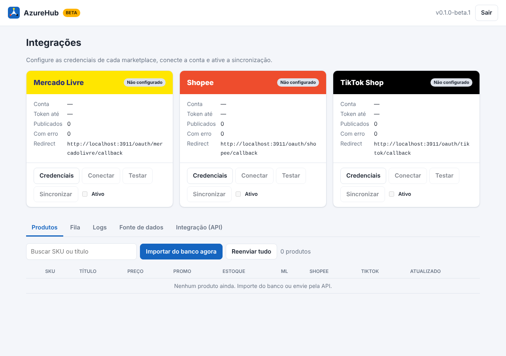

# AzureHub (beta)

Hub de integrações que publica os produtos de **qualquer site** no
**Mercado Livre**, na **Shopee** e no **TikTok Shop**. Envia título, descrição,
preço, preço promocional, estoque, peso/dimensões, marca/GTIN, fotos e vídeos.



> **Versão beta (0.1.0-beta.2).** O fluxo completo está implementado e coberto
> por testes com as APIs simuladas, mas ainda **não foi validado contra os
> sandboxes reais** das plataformas — ver [Antes de ir para produção](#antes-de-ir-para-produção).

## Como funciona

```
 Banco do site (MySQL/Postgres/SQLite) ──SELECT──┐
                                                 ├─► AzureHub ─► fila ─► Mercado Livre
 Site / ERP ── POST /api/v1/products ────────────┘   (normaliza,        ─► Shopee
                                                      detecta mudança)  ─► TikTok Shop
```

1. **Fonte de produtos.** Na instalação o hub pede as **credenciais do banco
   de dados do site** e uma consulta `SELECT` cujas colunas usam os nomes do
   hub (`sku`, `title`, `price`, `promo_price`, `images`…). Há modelos prontos
   (genérico e WooCommerce). Se o site preferir empurrar os dados, existe a
   API REST com chave (`X-Api-Key`).
2. **Normalização.** Todo produto vira um modelo único (ver
   `src/source/normalize.js`). Aceita preços no formato brasileiro (`1.234,50`)
   e listas de imagens em JSON ou separadas por vírgula, `;`, `|` ou quebra de linha.
3. **Detecção de mudança.** Cada produto tem um hash do conteúdo; só o que
   mudou entra na fila.
4. **Fila e reenvio.** Um envio por vez por plataforma (as três rodam em
   paralelo). Erros temporários (rede, 429, 5xx) são tentados de novo até
   5 vezes, com espera crescente (15 s → 30 min).
5. **Os 3 cards.** Cada plataforma tem seu card: credenciais, conectar a
   conta (OAuth), testar, ativar e sincronizar.

## Requisitos

- **Node.js 22.13+** (usa o SQLite embutido do Node, `node:sqlite`).
- Para ler o banco do site: `mysql2` (MySQL/MariaDB) ou `pg` (PostgreSQL). Os
  dois são instalados pelo `npm install` (são opcionais: se um falhar, o hub
  continua funcionando para os outros tipos).
- Em produção: **HTTPS** com URL pública (as três plataformas exigem HTTPS no
  retorno do OAuth) e fotos/vídeos em **URLs públicas**.

## Instalação

### Linux / VPS

```bash
cd AzureHub
bash install.sh        # confere o Node, instala os drivers e cria o .env com HUB_SECRET
nano .env              # ajuste PUBLIC_URL
npm start
```

Abra `PUBLIC_URL` no navegador e siga o assistente:

1. **Administrador**: e-mail e senha do painel.
2. **Banco de dados do site**: tipo, host, porta, usuário, senha, banco e a
   consulta. Use **Testar conexão** para ver uma amostra já validada.
3. **Concluir**: o hub mostra a **chave de API** uma única vez. Guarde-a.

### Docker

```bash
cp .env.example .env   # ajuste PUBLIC_URL e HUB_SECRET
docker compose up -d --build
```

### Rodar como serviço (systemd)

```ini
# /etc/systemd/system/azurehub.service
[Unit]
Description=AzureHub
After=network.target

[Service]
WorkingDirectory=/opt/azurehub
ExecStart=/usr/bin/node --no-warnings=ExperimentalWarning src/server.js
Restart=always
User=azurehub
EnvironmentFile=/opt/azurehub/.env

[Install]
WantedBy=multi-user.target
```

Atrás do nginx, publique com `proxy_pass http://127.0.0.1:3900;`.

### Variáveis (`.env`)

| Variável | Padrão | Uso |
|---|---|---|
| `PORT` | `3900` | Porta HTTP |
| `PUBLIC_URL` | `http://localhost:PORT` | Base dos redirect_uri do OAuth |
| `HUB_SECRET` | gerada em `data/.secret` | Chave mestra que cifra as credenciais. **Se perder, é preciso recadastrar tudo** |
| `HUB_DATA_DIR` | `data` | Pasta do banco interno |
| `MAX_MEDIA_MB` | `100` | Tamanho máximo de foto/vídeo baixado |
| `SESSION_HOURS` | `12` | Duração da sessão do painel |

## Credenciais de cada plataforma

Em todas, cadastre no app do desenvolvedor a **URL de retorno** exibida no card:
`<PUBLIC_URL>/oauth/<plataforma>/callback`.

### Mercado Livre
- Crie o app em <https://developers.mercadolivre.com.br/devcenter>.
- Informe **App ID** e **Chave secreta**; escopos `read`, `write`, `offline_access`.
- Categoria: usa `category_ml` do produto, depois a categoria padrão do card e,
  se nenhuma existir, **prevê pelo título** (`domain_discovery`).
- Promoção: campanha própria do vendedor (`PRICE_DISCOUNT`, `deal_price`).
- Vídeo: o anúncio aceita link do **YouTube** (`video_id`). Arquivos de vídeo
  (clips) ficam para a próxima versão; o hub avisa no log.

### Shopee
- Crie o app no Shopee Open Platform (<https://open.shopee.com>).
- Informe **Partner ID**, **Partner Key** e o ambiente (comece por `sandbox`).
- Categoria: `category_shopee` no produto ou **categoria padrão** (obrigatória).
- Fotos e vídeo são baixados do site e **enviados para a Shopee** (vídeo em
  partes de 4 MB). Promoção via `discount/add_discount`.

### TikTok Shop
Conector conferido com a referência oficial (<https://partner.tiktokshop.com/docv2>).

- Crie o app no TikTok Shop Partner Center (<https://partner.tiktokshop.com>).
- Informe **App Key**, **App Secret** e **Service ID**; cadastre o callback no app.
  Lojas dos EUA usam o host de autorização `services.us.tiktokshop.com`.
- A loja (`shop_cipher`, região) e o armazém de vendas ativo são descobertos
  automaticamente.
- **Categoria:** `category_tiktok` no produto, categoria padrão ou recomendação
  por título + descrição + fotos. Categoria recomendada sem permissão para a
  loja (`INVITE_ONLY`, `PROHIBITED`…) vira erro explicativo.
- **Atributos obrigatórios da categoria** são consultados e casados com
  `attributes` do produto (chave = nome ou id do atributo na TikTok, valor =
  nome ou id da opção). Se faltar algum, o erro lista quais são e as opções.
- **Fotos** (até 9, máx. 10 MB) e **vídeo** (máx. 100 MB; MP4, MOV, WEBM…) são
  enviados à TikTok. O nome do vídeo é saneado (sem espaços nem pontos extras).
- **Estoque**: a TikTok só aceita de 1 a 99.999 por SKU. Produto sem estoque ou
  inativo é **desativado** (e reativado quando o estoque volta); se ainda não
  existir na TikTok, a criação é adiada (status `skipped`).
- **Atualização sem auditoria desnecessária:** preço e estoque usam os
  endpoints próprios (publicação imediata); título, descrição, fotos, vídeo,
  peso e atributos só são reenviados (Partial Edit 202509, que dispara nova
  auditoria) quando mudam de fato.
- **GTIN/EAN** vai só na criação (a TikTok só permite alterá-lo em rascunho).
- **Promoção:** campanha `FIXED_PRICE` por produto; removida do produto quando
  o `promoPrice` some. Mudança de preço com promoção ativa pode ser recusada
  pela TikTok (vira aviso no log).
- Criação com `idempotency_key`: uma nova tentativa após queda de rede não
  duplica o produto.
- *Get Authorized Category Assets* (`/authorization/202405/category_assets`)
  é da autorização de **parceiro** (APIs de Affiliate Partner / TAP) e não se
  aplica à publicação de produtos do vendedor; o hub não o utiliza.

## API para o site

Autenticação: cabeçalho `X-Api-Key: azh_...` (gerada na instalação, renovável
na aba **Integração**).

| Método | Rota | Descrição |
|---|---|---|
| `POST` | `/api/v1/products` | Cria/atualiza 1 produto, uma lista ou `{ "products": [...] }` (até 1000) |
| `GET` | `/api/v1/products/:sku` | Produto + status em cada plataforma |
| `DELETE` | `/api/v1/products/:sku` | Desativa: zera o estoque nas plataformas (não apaga o anúncio) |

Formato do produto:

```json
{
  "sku": "CAM-001",
  "title": "Camiseta Algodão Azul",
  "description": "Texto ou HTML",
  "brand": "Minha Marca", "model": "Básica", "gtin": "7891234567895",
  "condition": "new",
  "price": 89.90,
  "promoPrice": 69.90,
  "promoStart": "2026-11-01T00:00:00-03:00",
  "promoEnd": "2026-11-30T23:59:59-03:00",
  "stock": 25,
  "weightKg": 0.3, "lengthCm": 30, "widthCm": 25, "heightCm": 3,
  "images": ["https://meusite.com/img/1.jpg"],
  "videos": ["https://meusite.com/video/1.mp4", "https://youtu.be/XXXXXXXXXXX"],
  "categories": { "mercadolivre": "MLB31447", "shopee": 100017, "tiktok": "601226" },
  "attributes": { "COLOR": "Azul" },
  "active": true
}
```

Obrigatórios: `sku`, `title`, `price > 0` e ao menos 1 imagem. A resposta traz
`received`, `changed`, `unchanged` e `invalid` (com o motivo de cada um).

## Segurança

- Credenciais e tokens das plataformas e a senha do banco do site ficam
  **cifrados** (AES-256-GCM) no banco interno. O painel nunca devolve um
  segredo: mostra só os 4 últimos caracteres.
- Senha do painel com scrypt; sessão em cookie `HttpOnly` (`Secure` quando a
  URL é HTTPS); login bloqueia por 10 minutos após 5 erros.
- A chave de API é guardada só como hash.
- A consulta da fonte precisa começar com `SELECT`/`WITH`, mas **use um usuário
  de banco somente-leitura**: essa é a proteção real.
- OAuth com `state` de uso único (expira em 15 min).

## Estrutura

```
src/
  server.js            servidor HTTP (sem Express) + arquivos do painel
  config.js            .env e caminhos
  routes/api.js        instalação, login, cards, produtos, fila, OAuth
  lib/store.js         banco interno (node:sqlite)
  lib/crypto.js        cofre AES-GCM, scrypt, HMAC
  lib/media.js         cliente HTTP comum + download de fotos/vídeos
  source/              leitura do banco do site, modelos de consulta, normalização
  platforms/           mercadolivre.js, shopee.js, tiktok.js (+ index: tokens/refresh)
  sync/engine.js       fila, reenvio com backoff, importação automática
public/                painel (HTML/CSS/JS puro)
test/                  node:test (APIs das plataformas simuladas)
```

Testes: `npm test` (28 casos: instalação, autenticação, cofre, publicação nas
três plataformas com fotos/vídeo/promoção, regras do TikTok (atributos,
estoque, desativação, edição parcial), backoff, fonte SQLite, assinaturas).

## Antes de ir para produção

Itens que o beta **ainda não cobre** ou que precisam ser conferidos nos sandboxes:

- [ ] **Validar nos sandboxes reais** com apps de teste das três plataformas
      (o TikTok já foi conferido contra a documentação oficial; falta a
      chamada real).
- [ ] **Atributos obrigatórios por categoria** no Mercado Livre e na Shopee
      (o TikTok já consulta e valida). Hoje os dois recebem marca, modelo, GTIN
      e `attributes` livres.
- [ ] **Variações** (cor/tamanho). O beta publica 1 SKU por anúncio.
- [ ] **Vídeo no Mercado Livre** por arquivo (clips); hoje só YouTube.
- [ ] **Webhooks/notificações** das plataformas (pedidos, perguntas, mudança
      de status do anúncio) — o beta é só de envio (site → marketplaces).
- [ ] Logística da Shopee por produto (hoje: canais do card ou todos os ativos).
- [ ] Hospedagem: subir na VPS com HTTPS (ex.: `https://azuresystem.com.br/azurehub`).

Documentação de referência:
[Mercado Livre](https://developers.mercadolivre.com.br/pt_br/api-docs-pt-br) ·
[Shopee Open Platform](https://open.shopee.com/documents) ·
[TikTok Shop Partner](https://partner.tiktokshop.com/docv2/page/create-product-202309) ·
[Plug4Market](https://api.plug4market.com.br/docs) (referência de modelo de hub) ·
[projetos no GitHub](https://github.com/topics/api-mercado-livre).
