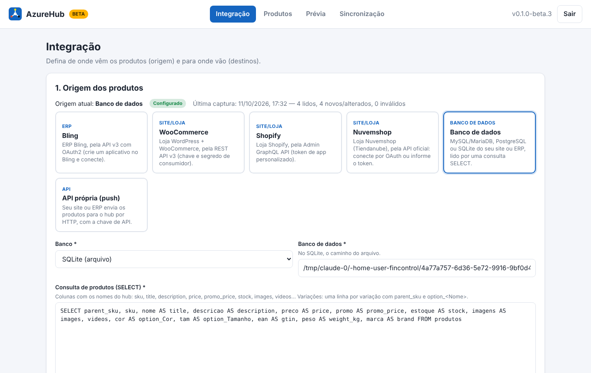
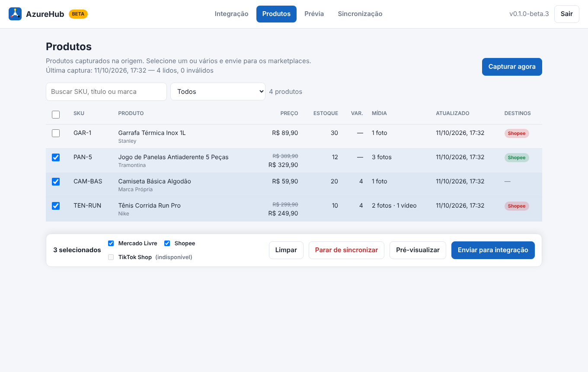
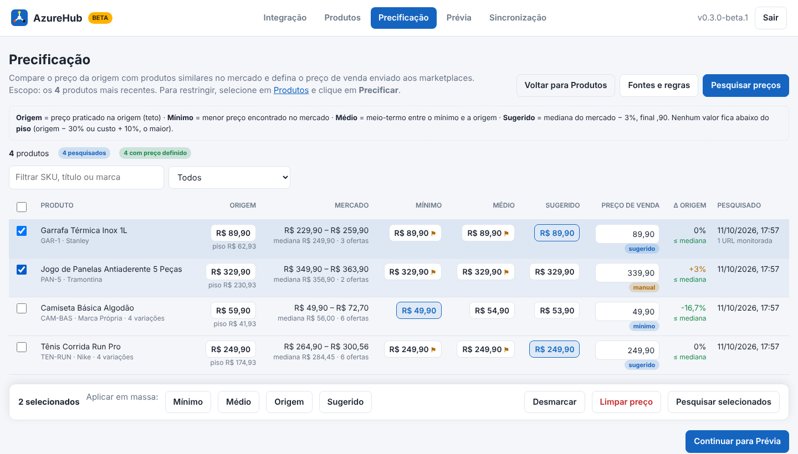
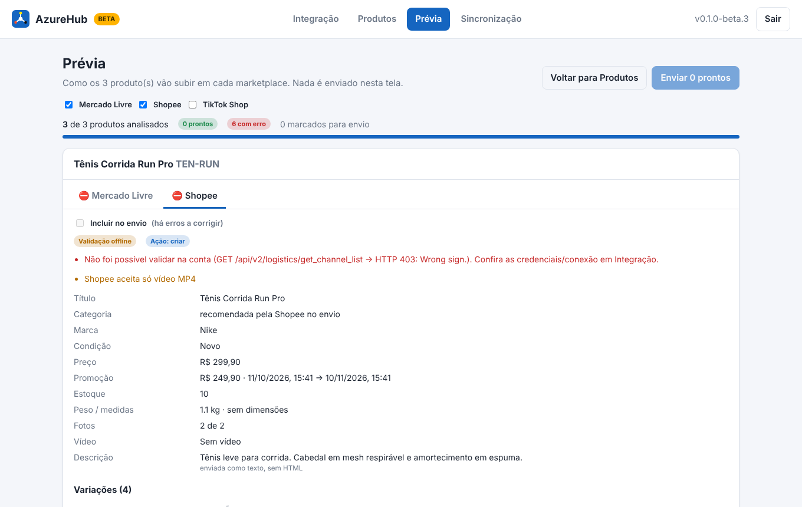
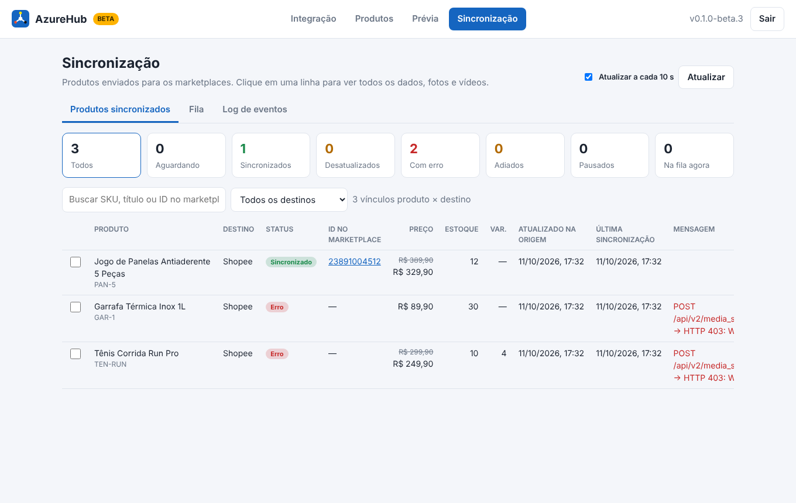
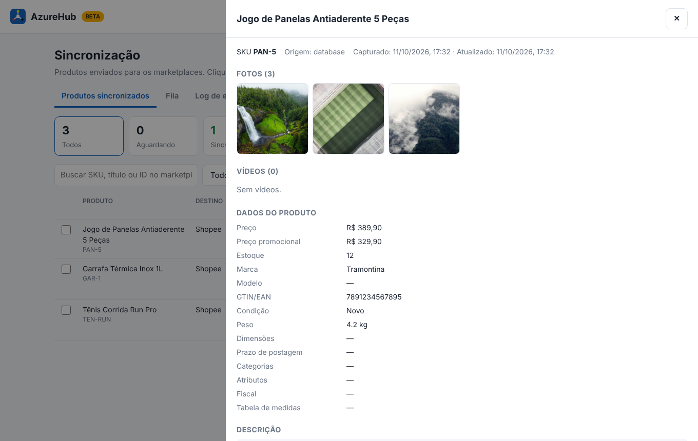
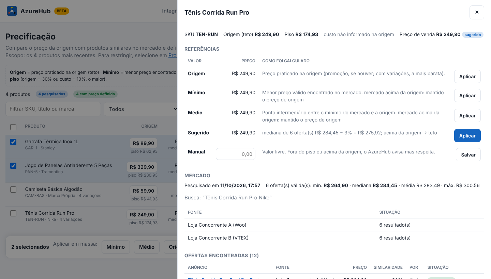

# AzureHub (beta)

Hub de integrações que leva os produtos do seu **ERP, loja ou site** para o
**Mercado Livre**, a **Shopee** e o **TikTok Shop**: título, descrição, preço,
preço promocional, estoque, peso/dimensões, marca/GTIN, variações, fotos e vídeos.

> **Versão beta (0.7.0-beta.2).** Fluxo completo implementado e coberto por
> testes com as APIs simuladas no formato da documentação oficial de cada
> plataforma; ainda **não validado contra os sandboxes reais** — ver
> [Antes de ir para produção](#antes-de-ir-para-produção).

> **Projeto próprio e independente.** O AzureHub não tem vínculo, parceria ou
> dependência com outros integradores ou plataformas (Bling, Shopify,
> Plug4Market, entre outros). Eles serviram apenas de **referência** — consulta
> à documentação pública, comparação de modelos e simulações nos testes. Os
> conectores de origem são **adaptadores opcionais** que usam as APIs públicas
> de cada plataforma: nenhum é obrigatório, e o hub funciona sozinho com um
> banco de dados ou com a API própria (`POST /api/v1/products`). O mesmo vale
> para o módulo de Precificação: as fontes de pesquisa são opcionais e
> trocáveis.

## Como funciona

```
 ORIGEM                                   AZUREHUB                                        DESTINOS
 Bling (ERP) ─┐                                                                       ┌─► Mercado Livre
 WooCommerce ─┤   captura    ┌──────────┐ seleção ┌──────────────┐     ┌───────┐ fila ├─► Shopee
 Shopify ─────┼────────────► │ Produtos │ ──────► │ Precificação │ ──► │Prévia │ ───► └─► TikTok Shop
 Nuvemshop ───┤  (manual ou  └──────────┘ (você   │  (opcional)  │     └───────┘ (envio,
 Banco SQL ───┤  automática)              escolhe)└──────▲───────┘               reenvio,
 API (push) ──┘                                          │ pesquisa de preços    atualização)
                                                  lojas VTEX/Shopify/Woo, API do ML,
                                                  páginas com JSON-LD, Scrapling
```

O painel tem cinco telas, mais a **Precificação** quando o módulo está ativo:

| Tela | O que faz |
|---|---|
| **Integração** | **Origem:** escolha o ERP/site (Bling, WooCommerce, Shopify, Nuvemshop, banco de dados ou API própria), informe as credenciais, teste e capture. **Destino:** os 3 cards dos marketplaces (credenciais, conectar, testar, ativar). |
| **Produtos** | Grade dos produtos capturados (SKU, título, preço/promoção, estoque, nº de variações, contagem de mídia, data de atualização e situação em cada destino). Selecione um ou vários, escolha os destinos e **pré-visualize** ou **envie para integração**. |
| **Precificação** *(módulo opcional)* | Entre Produtos e Prévia. Compara o preço da origem com produtos similares pesquisados no mercado e define o **preço de venda** enviado aos marketplaces — por produto ou **em massa** (mínimo, médio, origem ou sugerido). Ver [Precificação](#precificação-módulo-opcional). |
| **Prévia** | Como cada produto vai subir em cada marketplace — exatamente o que será enviado (título cortado, categoria, marca, atributos, GTIN, frete, promoção com a janela ajustada, variações…), com **erros** que bloqueiam e **avisos**. Nada é enviado nesta tela. Daqui saem também a **mídia UGC** (3 fotos e 1 vídeo com influencer gerados por IA) e a **auditoria com IA** de cada anúncio. |
| **Sincronização** | Grade produto × destino com status, ID no marketplace (com link), preço, estoque, data/hora da atualização na origem e da última sincronização, mensagem e situação na fila. Ao clicar, o **detalhe completo**: fotos, vídeos, todos os dados, variações, destinos e histórico. Fila e log de eventos em abas. |
| **Agentes de IA** | Provedores de IA (OpenAI, Google Gemini, xAI, DeepSeek, OpenRouter) com a sua chave e, para cada agente — mídia UGC, precificação, auditor, CRM —, o provedor e o modelo de cada função. Ver [Agentes de IA](#agentes-de-ia). |








Regras do fluxo:

1. **Captura não publica.** O que vem da origem fica em *Produtos*, esperando
   seleção. Só vai para um marketplace depois de **enviado para integração**.
2. **Depois de enviado, acompanha a origem.** Mudou na origem (preço, estoque,
   fotos…), a próxima captura detecta pelo hash e reenvia sozinho para os
   destinos em que o produto está. Em *Sincronização* ele aparece como
   **desatualizado** até o reenvio.
3. **Parar de sincronizar:** sem anúncio criado, o produto sai da integração;
   com anúncio, fica **pausado** (nada é apagado no marketplace).
4. **Fila e reenvio:** um envio por vez por marketplace (os três em paralelo);
   erros temporários (rede, 429, 5xx) são tentados até 5 vezes, com espera
   crescente (15 s → 30 min).
5. **Prévia** usa a conta conectada só com **endpoints de leitura** (categoria,
   atributos, marcas, limites, frete); sem conta, aplica as regras fixas de cada
   marketplace. Fotos e vídeos só são exibidos no detalhe da Sincronização.

## Precificação (módulo opcional)

Ative em **Integração › Módulos › Precificação**. A tela aparece entre
*Produtos* e *Prévia*: selecione produtos em *Produtos* e clique em
**Precificar** (sem seleção, a tela mostra os 200 mais recentes).



### Os valores de cada produto

| Valor | Como é calculado |
|---|---|
| **Origem** | Preço praticado na origem (o promocional, se houver; com variações, a mais barata). Aplicar *Origem* faz o produto **acompanhar a origem** (se ela mudar, o envio muda junto). |
| **Teto** | Por padrão, a própria origem: nenhuma referência passa dela. Com **Permitir preço acima da origem** (em *Fontes e regras*), o teto vira *origem + X%* (padrão 20%, até 300%): quando o mercado está acima, mínimo, médio e sugerido podem subir até ele. |
| **Mínimo** | Menor preço válido encontrado no mercado (o valor "raspado"). |
| **Médio** | Ponto intermediário entre o mínimo do mercado e a origem. |
| **Sugerido** | Mediana do mercado menos um desconto (padrão 3%), arredondada **para baixo** (final ,90, ,99 ou centavos). Se o mercado estiver acima do teto, fica o teto (a origem exata; um teto *origem + X%* também arredondado para baixo). |
| **Piso** | Proteção da margem: o maior entre *origem − desconto máximo* (padrão 30%) e *custo + margem mínima* (padrão 10%, quando a origem informa o custo — Bling, Nuvemshop, banco ou API com `cost`). Mínimo, médio e sugerido nunca ficam abaixo do piso nem acima do teto (⚑ na grade). Se o custo levar o piso acima do teto, vale o teto. |

Na grade, um clique em um valor aplica aquela referência ao produto; com
vários marcados, a barra **Aplicar em massa** aplica *Mínimo*, *Médio*,
*Origem* ou *Sugerido* a todos. O campo **Preço de venda** aceita um valor
manual (avisa se estiver abaixo do piso ou acima da origem). **Limpar preço**
volta a usar a origem.

**Como o preço chega aos marketplaces:** o preço de venda substitui o preço da
origem no envio (variações recebem o mesmo ajuste, proporcional). Um valor
aplicado (mínimo, médio ou sugerido) é conferido **de novo no envio** contra o
piso e o teto atuais: se a origem cair abaixo dele, ou o custo subir e levantar
o piso, o envio se ajusta sozinho e a grade mostra "enviado R$ …". O preço
**manual** vai como foi digitado. Com
*Enviar origem como preço "de"*, a origem vai como preço cheio e o preço de
venda como promoção (se o preço de venda for igual ou maior que o preço cheio,
não há "de/por": vai o preço de venda). Ligar, desligar ou mudar o % do teto
também reprocessa os preços aplicados. Mudar o preço de um produto já publicado o deixa
**desatualizado** e coloca o reenvio na fila; desligar o módulo devolve todos
ao preço da origem (também com reenvio).

### Fontes de pesquisa

Cadastradas em **Precificação › Fontes e regras** (várias de cada tipo):

| Fonte | Como pesquisa |
|---|---|
| **Mercado Livre (API oficial)** | Catálogo (`/products/search` por GTIN ou texto → `/products/{id}/items`) e, sem resultado, a busca de anúncios — com o token da conta conectada no destino Mercado Livre. A busca pública sem token responde 403. |
| **Loja VTEX** | API pública de busca do catálogo (`ft=` texto, `fq=alternateIds_Ean:` GTIN); só sellers com estoque. |
| **Loja Shopify** | Busca preditiva pública (`/search/suggest.json`), sem produtos esgotados. |
| **Loja WooCommerce** | Store API pública (`/wp-json/wc/store/v1/products`), sem autenticação. |
| **Site (dados estruturados)** | Página de busca ou de produto com JSON-LD schema.org (`Product`/`Offer`/`AggregateOffer`/`ItemList`) ou metatags de preço — o que as lojas publicam para os buscadores. Não depende do layout. |
| **Site por seletores CSS (Scrapling)** | Para páginas sem dados estruturados: você informa os seletores CSS e o trabalhador Python ([Scrapling](https://github.com/D4Vinci/Scrapling)) extrai título, preço e link. Opção de navegador para páginas que dependem de JavaScript. |
| **URLs monitoradas** | Por produto (no detalhe da linha): páginas de concorrentes que vendem **o mesmo item**; entram com similaridade 100%. |

**Como as ofertas são escolhidas:** busca primeiro pelo **GTIN** (quando o
produto tem) e, sem resultado, pelo título + marca. Cada oferta recebe uma
nota de similaridade (palavras em comum, marca, e números do título — `1L` ≠
`500ml`); abaixo do mínimo configurado (padrão 45%) é descartada, assim como
produtos **usados** (pela condição ou pelo título: "usado", "seminovo",
"vitrine"…), ofertas em **outra moeda** e preços **fora da curva** (abaixo de
40% ou acima de 250% da mediana: acessórios, kits, erros). O mesmo anúncio
encontrado duas vezes (ex.: URL monitorada que também veio na busca) conta uma
vez só. O detalhe mostra todas as ofertas, com o
motivo de cada descarte, e a situação de cada fonte.

### Coleta responsável

- O robô se identifica pelo User-Agent `AzureHubPriceBot/<versão> (+<PUBLIC_URL>; pesquisa de precos)`.
- Respeita o `robots.txt` de cada site (como o `ROBOTSTXT_OBEY` do
  [Scrapy](https://github.com/scrapy/scrapy)): regra mais específica vence;
  `robots.txt` fora do ar (5xx) bloqueia. Desligue por fonte só em sites seus
  ou com autorização expressa.
- Espera entre requisições ao mesmo site (1,5 a 3 s; configurável por fonte)
  e guarda as respostas em cache (padrão 12 h).
- **Não** contorna captcha, login, *paywall* ou bloqueios anti-robô: os
  recursos de disfarce do Scrapling (cabeçalhos *stealth*, referer do Google,
  `StealthyFetcher`) ficam desligados. Prefira APIs públicas e use só fontes
  cujos termos de uso permitam a consulta.
- O preço da busca pode não incluir frete, desconto no Pix ou cupom: trate o
  mercado como referência, não como verdade.

**Proteções de rede.** As URLs das fontes e as monitoradas são buscadas pelo
servidor, então o hub recusa endereços internos — loopback, redes privadas,
link-local (inclusive o serviço de metadados da nuvem, `169.254.169.254`),
`localhost`/`.local` — conferindo o DNS antes de cada requisição e **a cada
redirecionamento** (até 5). Só `http(s)`, sem usuário/senha na URL, resposta de
no máximo 5 MB e cache em memória com no máximo 1000 entradas. Para pesquisar
uma loja na sua rede local (teste), defina `PRICE_ALLOW_PRIVATE=1`.
Limitação: o trabalhador Python do Scrapling segue redirecionamentos por conta
própria — o AzureHub confere só a URL inicial.

### Scrapling (opcional)

Só a fonte *Site por seletores CSS* precisa de Python. No servidor:

```bash
python3 -m venv /opt/azurehub-scraper
/opt/azurehub-scraper/bin/pip install "scrapling[fetchers]"   # Python 3.10+
/opt/azurehub-scraper/bin/scrapling install                   # só para o modo navegador
echo 'PRICE_SCRAPER_CMD=/opt/azurehub-scraper/bin/python' >> .env
```

O Node verifica o `robots.txt` e o intervalo, chama `scraper/scrapling_worker.py`
(JSON na entrada e na saída) e trata o resultado. A imagem Docker não traz
Python: para usar esta fonte em Docker, estenda a imagem.

## Agentes de IA

Tela **Agentes de IA**: você conecta os provedores de IA com a **sua chave de
API** (cifrada no servidor; cada provedor cobra direto na sua conta) e escolhe,
para cada agente, **qual provedor e qual modelo** executa cada função.

| Agente | Onde age | Funções (modelo) |
|---|---|---|
| **Geração de mídia UGC** | Prévia › *Gerar mídia UGC* | roteiro (texto, opcional), fotos (imagem), vídeo falado (vídeo) |
| **Precificação** | pesquisa de mercado | confere se cada oferta é mesmo o mesmo produto (texto, opcional) |
| **Auditor de anúncios** | Prévia › *Auditar com IA* | revisa o anúncio de cada marketplace (texto) |
| **CRM (atendimento)** | *em breve* | a escolha do modelo já fica salva |

Provedores:

| Provedor | Texto | Imagem | Vídeo | Observações |
|---|---|---|---|---|
| **OpenAI** | GPT (`gpt-6-luna`…) | GPT Image 2.5 (`gpt-image-2.5-sunburst`) | — | A OpenAI desligou a API de vídeo (Sora) em 24/09/2026 |
| **Google Gemini** | `gemini-3.6-flash` | Nano Banana 2.1 (`gemini-nano-banana-2.1`) | Gemini Omni (`gemini-omni-1.1-flash`, 3–10 s, áudio nativo) | Interactions API; exige projeto com faturamento |
| **xAI (Grok)** | `grok-4.3` | Grok Imagine Image 2.0 | Grok Imagine Video 1.5 (até 15 s, sincronia labial, referências de pessoa e produto) | sem 4:5 nas fotos (usa 3:4) |
| **DeepSeek** | `deepseek-flash`, `deepseek-v4-pro` | — | — | texto muito barato; a API da DeepSeek não gera imagem nem vídeo |
| **OpenRouter** | centenas de modelos — recomendados: `meta-llama/llama-3.3-70b-instruct`, `meta-llama/llama-3.1-8b-instruct`, `qwen/qwen3-14b` | Nano Banana, GPT Image, Seedream, Grok, FLUX… | Grok Imagine, Veo 3.1, Seedance, Kling… | **uma chave só** para todos |

Em cada função dá para digitar o id de **qualquer** modelo do provedor (as
listas são sugestões). Modelo vazio usa o padrão do provedor.

**Por que OpenRouter.** Em vez de abrir conta em cinco provedores, uma chave do
OpenRouter dá acesso aos modelos de todos eles; cada pedido vai ao fornecedor
**mais barato** do modelo naquele momento (`provider.sort: "price"`, ajustável
para mais rápido ou menor latência na conexão), e trocar de modelo é mudar só o
nome na tela. O hub pede JSON com o plugin de conserto (`response-healing`),
respeita o limite de imagens de referência e as proporções de cada modelo de
imagem (ex.: Grok aceita 3 fotos e não tem 4:5 → 3:4) e ajusta a duração do
vídeo à mais próxima que o modelo aceita. Observação de out/2026: o
`qwen/qwen3-8b` ficou **sem fornecedor** no OpenRouter (e o `qwen3.5-9b` sai do
catálogo em 21/10/2026); o `qwen/qwen3-14b` é o Qwen pequeno mais próximo.

### Geração de mídia UGC (Prévia)

Para cada produto, o agente cria 4 mídias com um(a) **influencer fictício(a)**
(persona gerada por IA, nunca uma pessoa real) do gênero escolhido:

1. foto do influencer **usando** o produto;
2. foto do influencer **segurando** o produto;
3. arte do produto com **especificações e vantagens** (texto em português);
4. **vídeo** vertical 9:16 do influencer falando do produto, com **CTA logo no
   início**, qualidades e vantagens no uso diário.

- **Roteiro:** o modelo de texto escreve os 4 prompts a partir só dos dados
  reais do produto; sem modelo de texto, valem os prompts-padrão do AzureHub.
  Cada prompt fica numa caixa de texto **editável** e cada mídia pode ser
  **gerada de novo** sozinha com o prompt alterado.
- **Fidelidade:** até 3 fotos reais do produto vão como referência em toda
  geração; a foto 1 pronta vira a referência da **persona** nas mídias 2 e 4
  (a mesma pessoa em todas).
- **Fila:** em segundo plano (2 fotos e 2 vídeos ao mesmo tempo). O vídeo é
  assíncrono: o id do job fica gravado e, se o servidor reiniciar, a consulta
  continua de onde parou — sem gerar (e pagar) de novo.
- **Vários produtos:** *Gerar para os N produtos* usa os prompts já editados de
  cada produto ou pede o roteiro ao agente.
- Arquivos em `data/ugc/<sku>/`, servidos só com login; botão **Baixar** em cada
  mídia. Enquanto uma nova versão é gerada (ou se ela falhar), a anterior
  continua visível.
- **Rotule como conteúdo gerado por IA** quando o marketplace exigir; as
  imagens do Google levam SynthID e as da OpenAI, credenciais C2PA.

### Precificação com IA

Com um modelo escolhido no agente **Precificação**, a pesquisa de mercado manda
ao modelo as ofertas em dúvida (similaridade entre o mínimo − 25 pontos e 99%):
ele **descarta** as parecidas (outro tamanho, kit, refil, acessório, usado) e
**recupera** as iguais com título bem diferente. Oferta pelo mesmo código de
barras ou por URL monitorada não passa pela IA. Se o modelo falhar, vale a
similaridade do título e a tela mostra o motivo.

### Auditor de anúncios

Na Prévia, **Auditar com IA** manda ao modelo os dados do produto e exatamente
o que vai subir em cada marketplace (campos, erros e avisos da prévia). Volta
uma **nota**, **achados** por gravidade (problema + sugestão) e um **título
sugerido** por marketplace dentro do limite de caracteres. Só lê: nada é
alterado sozinho. A última auditoria de cada produto fica salva.

## Origens de produtos

| Origem | Como conecta | O que é capturado |
|---|---|---|
| **Bling** (ERP) | API v3, OAuth2: crie um app no Bling (escopo Produtos), informe Client ID/secret, salve e clique em **Conectar**. Token de 6 h renovado sozinho (refresh de 30 dias). | Produtos ativos (lista + detalhe): nome, código, descrição complementar, preço, estoque virtual, GTIN, marca, peso bruto, dimensões (m/cm/mm → cm), NCM/CEST/origem, imagens externas e internas, vídeo, variações (`Cor:Azul;Tamanho:P`). Respeita 3 req/s. |
| **WooCommerce** | REST API v3 com chave/segredo de consumidor (permissão leitura). | Produtos publicados, preço normal/promocional e período, estoque (ou quantidade padrão quando a loja não controla), GTIN (`global_unique_id`), marca, peso/medidas com a unidade da loja, atributos e variações. |
| **Shopify** | Admin GraphQL API **2026-10**, token de app personalizado (`read_products`, `read_inventory`). | Produtos ativos: `compareAtPrice` vira preço "de" e `price` a promoção, código de barras (`barcodes`), peso, fotos e vídeos (MP4/YouTube), variações (paginadas; respeita o limite de custo de 1000 pontos). |
| **Nuvemshop** | API `2025-03`: OAuth (App ID + secret) ou store_id + token; exige e-mail de contato (User-Agent). | Produtos publicados no idioma escolhido, preço/promoção, estoque (vazio = "infinito" → quantidade padrão), GTIN (`barcode`), peso/medidas, fotos ordenadas, vídeo, variações. |
| **Banco de dados** | MySQL/MariaDB, PostgreSQL ou SQLite + uma consulta `SELECT` (modelos genérico e WooCommerce). | O que a consulta devolver com os nomes do hub; variações com `parent_sku` + `option_<Nome>`. |
| **API própria** | O site faz `POST /api/v1/products` com `X-Api-Key`. | O JSON enviado (ver [API para o site](#api-para-o-site)). |

Para Bling e Nuvemshop, cadastre no app a **URL de redirecionamento** mostrada
na tela: `<PUBLIC_URL>/oauth/source/<origem>/callback`.

> **Bling:** as imagens *internas* têm validade. Se o envio ao marketplace
> acontecer muito depois da captura, o link pode expirar — mantenha a captura
> automática ligada ou prefira imagens externas.

## Requisitos

- **Node.js 22.13+** (usa o SQLite embutido do Node, `node:sqlite`).
- Para ler o banco do site: `mysql2` (MySQL/MariaDB) ou `pg` (PostgreSQL). Os
  dois são instalados pelo `npm install` (são opcionais: se um falhar, o hub
  continua funcionando para os outros tipos).
- Opcional, só para a fonte *Site por seletores CSS* da Precificação:
  **Python 3.10+** com Scrapling (ver [Scrapling](#scrapling-opcional)).
- Em produção: **HTTPS** com URL pública (as três plataformas exigem HTTPS no
  retorno do OAuth) e fotos/vídeos em **URLs públicas**.

## Instalação

### Linux / VPS

```bash
cd AzureHub
bash install.sh        # confere o Node, instala os drivers e cria o .env com HUB_SECRET
nano .env              # ajuste PUBLIC_URL
npm start
```

Abra `PUBLIC_URL` no navegador e siga o assistente:

1. **Administrador**: e-mail e senha do painel.
2. **Origem dos produtos**: escolha Bling, WooCommerce, Shopify, Nuvemshop,
   banco de dados ou API própria e preencha as credenciais. **Testar conexão**
   mostra uma amostra já normalizada e validada. (Bling/Nuvemshop por OAuth:
   a conexão é concluída depois, em *Integração › Conectar*.)
3. **Concluir**: o hub mostra a **chave de API** uma única vez. Guarde-a.

Depois: em **Integração**, conecte e ative os marketplaces; clique em
**Capturar produtos agora**; em **Produtos**, selecione e envie.

### Docker

```bash
cp .env.example .env   # ajuste PUBLIC_URL e HUB_SECRET
docker compose up -d --build
```

### Rodar como serviço (systemd)

```ini
# /etc/systemd/system/azurehub.service
[Unit]
Description=AzureHub
After=network.target

[Service]
WorkingDirectory=/opt/azurehub
ExecStart=/usr/bin/node --no-warnings=ExperimentalWarning src/server.js
Restart=always
User=azurehub
EnvironmentFile=/opt/azurehub/.env

[Install]
WantedBy=multi-user.target
```

Atrás do nginx, publique com `proxy_pass http://127.0.0.1:3900;` e
`proxy_set_header X-Real-IP $remote_addr;` (o bloqueio de tentativas de login
usa o IP real do cliente; sem esse cabeçalho, todos aparecem como 127.0.0.1).

### Variáveis (`.env`)

| Variável | Padrão | Uso |
|---|---|---|
| `PORT` | `3900` | Porta HTTP |
| `PUBLIC_URL` | `http://localhost:PORT` | Base dos redirect_uri do OAuth |
| `HUB_SECRET` | gerada em `data/.secret` | Chave mestra que cifra as credenciais. **Se perder, é preciso recadastrar tudo** |
| `HUB_DATA_DIR` | `data` | Pasta do banco interno |
| `MAX_MEDIA_MB` | `100` | Tamanho máximo de foto/vídeo baixado |
| `SESSION_HOURS` | `12` | Duração da sessão do painel |
| `PRICE_SCRAPER_CMD` | `python3` | Python usado pela fonte Scrapling da Precificação (ex.: `/opt/azurehub-scraper/bin/python`) |
| `SYNC_CONCURRENCY` | `2` | Envios simultâneos por marketplace (1 a 8; nunca dois do mesmo produto) |
| `PRICE_ALLOW_PRIVATE` | vazio | `1` libera a pesquisa de preços em endereços da rede interna (só para testes) |

## Comportamento do motor de sincronização

- Cada marketplace tem uma fila; até `SYNC_CONCURRENCY` produtos são enviados
  ao mesmo tempo. Erros temporários (rede, limite de uso, 5xx) voltam à fila
  com espera crescente (15 s até 30 min, 5 tentativas).
- **Falha depois de criar o anúncio** (ex.: a descrição no Mercado Livre): o
  id é guardado e a nova tentativa continua dele, sem duplicar.
- **Preço recusado** porque há promoção ativa na plataforma: o hub tira a
  promoção/desconto antes de mudar o preço e a recria depois. Se mesmo assim
  a plataforma recusar, o produto não fica "sincronizado": volta à fila a
  cada 30 min (até 6 vezes).
- **Fim da promoção:** o hub agenda um novo envio para o fim da campanha, que
  encerra ou renova a promoção.
- **Parar de sincronizar** durante um envio em andamento mantém o anúncio
  vinculado e pausado. Reativar o destino reenfileira o que mudou enquanto
  ele estava desligado. A API `POST /api/integrations/stop` aceita
  `"unlink": true` para esquecer o anúncio (ele continua na plataforma e um
  novo envio cria outro).
- **Captura:** produtos que somem da origem viram inativos (estoque 0) e os
  anúncios são pausados; captura vazia nunca desativa nada. Cada lote da
  captura roda numa transação (20 mil produtos em poucos segundos). Jobs
  concluídos há mais de 14 dias são apagados automaticamente.
- Shopify: estoque não rastreado vai como 999 (venda sem limite).

## Destinos (marketplaces)

Em todos, cadastre no app do desenvolvedor a **URL de retorno** exibida no card:
`<PUBLIC_URL>/oauth/<plataforma>/callback`.

### Mercado Livre
- Crie o app em <https://developers.mercadolivre.com.br/devcenter>.
- Informe **App ID** e **Chave secreta**; escopos `read`, `write`, `offline_access`.
- Categoria: usa `category_ml` do produto, depois a categoria padrão do card e,
  se nenhuma existir, **prevê pelo título** (`domain_discovery`).
- **Atributos da categoria** (`/categories/{id}/attributes`): os `attributes`
  do produto podem vir pelo **nome** ("Gênero", "Tipo de manga") ou pelo id
  do ML (`GENDER`) e são convertidos conforme o tipo — lista (só valores da
  lista; o erro mostra as opções), sim/não (pelo id), número com unidade
  (`"128GB"` → `128 GB`, só unidades aceitas), número e texto (até o limite
  de caracteres). Obrigatórios (`required`, `new_required` e os
  condicionais, conferidos em `/attributes/conditional`) faltando **barram a
  criação** com a lista do que falta; num anúncio já publicado viram aviso e
  preço/estoque seguem atualizando.
- **Dimensões do pacote** vão também como `SELLER_PACKAGE_HEIGHT/WIDTH/LENGTH/
  WEIGHT` (inteiros em cm e g), exigidos para vendedores ME2.
- Promoção: campanha própria do vendedor (`PRICE_DISCOUNT`, `deal_price`),
  de no máximo **14 dias** (regra do ML): sem data de fim, ou com fim mais
  longe, o hub pede 14 dias e renova quando a campanha termina. Só recria
  quando o preço ou as datas mudam, e **remove** a campanha quando a promoção
  sai da origem.
- Produto inativo na origem pausa o anúncio; ativo de novo, o hub reativa.
- Vídeo: o anúncio aceita link do **YouTube** (`video_id`). Arquivos de vídeo
  (clips) ficam para a próxima versão; o hub avisa no log.
- **Variações** (tênis, roupas): o ML tem dois modelos e o hub escolhe pela
  conta (`GET /users/me` → tag `user_product_seller`):
  - **User Products** (contas migradas): cada variação vira um anúncio próprio,
    com `family_name` (sem `title` nem `variations`), preço e estoque por
    variação; o ML agrupa os anúncios na mesma família. Variação sem estoque
    tem o anúncio criado quando houver estoque; variação removida na origem
    tem o anúncio **pausado** (encerrar não tem volta). Antes de criar, o hub
    procura pelo `SELLER_SKU` para nunca duplicar. Cor/tamanho de um anúncio
    já criado só mudam pelo editor de família do ML.
  - **Clássico**: um anúncio com `variations` (`attribute_combinations`, fotos,
    `SELLER_SKU` e GTIN por variação). O preço é **único**: com preços
    diferentes, vai o maior para todas (o ML cobraria o maior de qualquer
    forma) e o hub avisa. No PUT, todas as variações que ficam vão com `id`
    (as omitidas são apagadas pelo ML). Promoção só se todas as variações
    tiverem.
  - As opções do produto (`Cor`, `Tamanho`...) são casadas com os atributos da
    categoria que permitem variação (`COLOR`, `SIZE`...). Mesma cor = mesmas
    fotos (regra `defines_picture`). Se a conta migrou e o cache ainda dizia
    "clássico", o erro do ML faz o hub refazer no modelo User Products.

### Shopee
Conector conferido com a documentação oficial (<https://open.shopee.com/developer-guide/211>
e referência das APIs v2).

- Crie o app no Shopee Open Platform Console. Informe **Partner ID**, **Partner
  Key**, ambiente (`sandbox` / `production`) e região (`BR` usa
  `open.shopee.com.br` e `openplatform.shopee.com.br`; sandbox usa
  `openplatform.sandbox.test-stable.shopee.sg`). O Partner ID de teste só vale
  no sandbox.
- **No Console:** cadastre o domínio do hub em *Redirect URL Domain* (teste e
  produção) e declare o **IP do servidor** no *IP Address Whitelist* — a Shopee
  exige isso para todos os apps, e depois de ativado só os IPs declarados
  conseguem chamar a API.
- A autorização da loja vale **no máximo 365 dias** (o vendedor escolhe); o
  card mostra a data de expiração após o teste. Contas principais (várias
  lojas) são aceitas; o hub publica na primeira loja autorizada.
- **Antes de criar**, o hub consulta e valida tudo o que a categoria exige:
  - categoria: `category_shopee`, padrão do card ou recomendação por título + capa;
  - **limites** (`get_item_limit`): tamanho do título/descrição, nº de fotos,
    faixa de preço, estoque, GTIN, peso/dimensão obrigatórios, tabela de
    medidas e prazo de postagem;
  - **atributos** obrigatórios (`get_attribute_tree`), respeitando o tipo de
    campo: lista fechada, lista + valor livre, texto, múltipla escolha, número
    inteiro, **unidade** (ex.: `"2,5 L"`) e **data** (`"03/2026"`). Atributos
    filhos do valor escolhido também são tratados;
  - **marca** (`get_brand_list`, todas as páginas); marca não cadastrada na
    Shopee vira "Sem marca" com aviso;
  - **GTIN** pela regra da categoria: *Mandatory* (exige EAN válido, com
    dígito verificador), *Flexible* (envia `"00"` se não houver) ou *Optional*;
  - **canais logísticos** ativos (`enabled` e `mask_channel_id = 0`),
    descartando os que não comportam o peso/medidas ou exigem configuração
    manual de frete.
- **Variações** (tênis, roupas): até 2 níveis e 50 combinações, no formato
  padronizado `standardise_tier_variation` (o `tier_variation` foi
  descontinuado em 09/2025). "Cor"/"Tamanho" casam com "Color"/"Size"; opção
  fora da lista vai pelo nome. Variação que não existe na lista padronizada
  (ex.: "Estampa") cai na estrutura livre, com aviso. Uma foto por opção do
  1º nível (ex.: por cor). No BR, a variação mais cara não pode passar de **4×**
  a mais barata. O anúncio nasce oculto e só é listado depois que as variações
  existem; se a criação das variações falhar, o id do anúncio é guardado para
  não duplicar.
- **Tabela de medidas**: `sizeChart` (URL da imagem) ou `sizeChartId` (modelo
  da loja). Categorias que exigem tabela recusam o produto sem ela.
- **Pré-venda**: `daysToShip` acima do prazo padrão vira pré-venda, se a
  categoria permitir e dentro da faixa dela.
- **Fiscal (BR)**: `ncm`, `cest`, `origem` (ou o objeto `tax`) vão em `tax_info`.
- **Vídeo**: só MP4 até 30 MB (10 a 60 s), enviado em partes de 4 MB. Se a
  Shopee ainda estiver processando, o anúncio sai sem vídeo e o hub volta
  depois para anexá-lo.
- **Atualização**: `update_item` só quando título, descrição, fotos, atributos
  etc. mudam (a Shopee revalida o anúncio inteiro a cada edição); preço e
  estoque por modelo, só dos que mudaram. Inativo = deslistar (não apaga).
- **Desconto**: começa ao menos 1 h no futuro e dura menos de 180 dias (o hub
  ajusta e avisa). Com desconto ativo a Shopee não deixa mudar o preço
  original: isso vira aviso no log, sem travar o resto.
- Falhas parciais que a Shopee devolve com sucesso HTTP (`failure_list`,
  `error_list`) são verificadas em todas as chamadas em lote.

### TikTok Shop
Conector conferido com a referência oficial (<https://partner.tiktokshop.com/docv2>).

- Crie o app no TikTok Shop Partner Center (<https://partner.tiktokshop.com>).
- Informe **App Key**, **App Secret** e **Service ID**; cadastre o callback no app.
  Lojas dos EUA usam o host de autorização `services.us.tiktokshop.com`.
- A loja (`shop_cipher`, região) e o armazém de vendas ativo são descobertos
  automaticamente.
- **Categoria:** `category_tiktok` no produto, categoria padrão ou recomendação
  por título + descrição + fotos. Categoria recomendada sem permissão para a
  loja (`INVITE_ONLY`, `PROHIBITED`…) vira erro explicativo.
- **Atributos obrigatórios da categoria** são consultados e casados com
  `attributes` do produto (chave = nome ou id do atributo na TikTok, valor =
  nome ou id da opção). Se faltar algum, o erro lista quais são e as opções.
- **Fotos** (até 9, máx. 10 MB) e **vídeo** (máx. 100 MB; MP4, MOV, WEBM…) são
  enviados à TikTok. O nome do vídeo é saneado (sem espaços nem pontos extras).
- **Estoque**: a TikTok só aceita de 1 a 99.999 por SKU. Produto sem estoque ou
  inativo é **desativado** (e reativado quando o estoque volta); se ainda não
  existir na TikTok, a criação é adiada (status `skipped`).
- **Atualização sem auditoria desnecessária:** preço e estoque usam os
  endpoints próprios (publicação imediata); título, descrição, fotos, vídeo,
  peso e atributos só são reenviados (Partial Edit 202509, que dispara nova
  auditoria) quando mudam de fato.
- **GTIN/EAN** vai só na criação (a TikTok só permite alterá-lo em rascunho).
- **Promoção:** campanha `FIXED_PRICE` por produto; removida do produto quando
  o `promoPrice` some. Mudança de preço com promoção ativa pode ser recusada
  pela TikTok (vira aviso no log).
- Criação com `idempotency_key`: uma nova tentativa após queda de rede não
  duplica o produto.
- *Get Authorized Category Assets* (`/authorization/202405/category_assets`)
  é da autorização de **parceiro** (APIs de Affiliate Partner / TAP) e não se
  aplica à publicação de produtos do vendedor; o hub não o utiliza.
- **Variações**: uma SKU por variação, com `sales_attributes` (até 3 tipos;
  nome até 20 e valor até 50 caracteres; até 300 SKUs no BR). Cada opção usa o
  atributo de venda **padrão** da categoria quando existe (Cor ↔ Color,
  Tamanho ↔ Size, por `value_id` quando o valor está na lista) e, se não,
  um atributo **personalizado**. Uma foto por valor do 1º tipo (ex.: por cor,
  `use_case ATTRIBUTE_IMAGE`). Preço, estoque e GTIN (único) por SKU.
  - Preço e estoque mudam pelos endpoints próprios, sem auditoria. Variação
    nova, removida ou com opções alteradas vai por *Partial Edit* com a lista
    **completa** de SKUs (a TikTok apaga as omitidas), com os ids lidos do
    *Get Product*.
  - A TikTok documenta estoque por SKU de 1 a 99.999: variação sem estoque fica
    fora na criação; quando zera depois, o hub tenta 0 e, se recusado, tira a
    SKU do anúncio (volta quando houver estoque). Todas sem estoque = produto
    desativado.
  - Promoção por SKU (`product_level: VARIATION`), só nas variações com preço
    promocional.

## API para o site

Autenticação: cabeçalho `X-Api-Key: azh_...` (gerada na instalação, renovável
em **Integração** quando a origem é "API própria").

Os produtos enviados aparecem em **Produtos** para seleção. Para já enviá-los
para integração, use `?send=shopee,tiktok,mercadolivre` (ou `?send=all`):
`POST /api/v1/products?send=shopee`.

| Método | Rota | Descrição |
|---|---|---|
| `POST` | `/api/v1/products` | Cria/atualiza 1 produto, uma lista ou `{ "products": [...] }` (até 1000) |
| `GET` | `/api/v1/products/:sku` | Produto + status em cada plataforma |
| `DELETE` | `/api/v1/products/:sku` | Desativa: zera o estoque nas plataformas (não apaga o anúncio) |

Formato do produto:

```json
{
  "sku": "CAM-001",
  "title": "Camiseta Algodão Azul",
  "description": "Texto ou HTML",
  "brand": "Minha Marca", "model": "Básica", "gtin": "7891234567895",
  "condition": "new",
  "price": 89.90,
  "promoPrice": 69.90,
  "promoStart": "2026-11-01T00:00:00-03:00",
  "promoEnd": "2026-11-30T23:59:59-03:00",
  "cost": 42.00,
  "stock": 25,
  "weightKg": 0.3, "lengthCm": 30, "widthCm": 25, "heightCm": 3,
  "images": ["https://meusite.com/img/1.jpg"],
  "videos": ["https://meusite.com/video/1.mp4", "https://youtu.be/XXXXXXXXXXX"],
  "categories": { "mercadolivre": "MLB31447", "shopee": 100017, "tiktok": "601226" },
  "attributes": { "Material": "Algodão", "Capacidade": "2,5 L" },
  "sizeChart": "https://meusite.com/img/tabela-medidas.png",
  "daysToShip": 10,
  "ncm": "61091000",
  "active": true,
  "variants": [
    { "sku": "CAM-001-AZ-P", "options": { "Cor": "Azul", "Tamanho": "P" }, "price": 89.90, "stock": 5,
      "gtin": "7891234567895", "images": ["https://meusite.com/img/azul.jpg"] },
    { "sku": "CAM-001-AZ-M", "options": { "Cor": "Azul", "Tamanho": "M" }, "price": 89.90, "stock": 3 }
  ]
}
```

Obrigatórios: `sku`, `title`, `price > 0` e ao menos 1 imagem. A resposta traz
`received`, `changed`, `unchanged` e `invalid` (com o motivo de cada um).

- `cost` (opcional): custo do produto. Só é usado pela Precificação, para o
  piso de margem mínima; nunca é enviado aos marketplaces. No banco, as
  colunas `cost`, `custo` ou `preco_custo`.
- `attributes`: a chave é o **nome** (ou id) do atributo na plataforma e o
  valor é o nome (ou id) da opção. Quando falta um atributo obrigatório, o log
  diz qual é e lista as opções.
- `variants`: todas as variações precisam ter as mesmas chaves em `options`.
  Preço/estoque do produto passam a ser derivados delas; `promoPrice` do
  produto vale para as variações sem promoção própria.
- Os três marketplaces publicam variações (ver cada destino acima). Use nas
  `options` os nomes que os marketplaces conhecem (`Cor`, `Tamanho`,
  `Voltagem`...) para cair nos atributos padrão de cada categoria.

### Variações vindas do banco do site

Uma linha por variação, com `parent_sku` (o SKU do produto) e colunas
`option_<Nome>`:

```sql
SELECT p.codigo AS parent_sku, v.sku, p.nome AS title, p.descricao AS description,
       v.preco AS price, v.estoque AS stock, v.ean AS gtin, p.imagens AS images,
       v.imagem AS variant_images, v.cor AS option_Cor, v.tamanho AS option_Tamanho
FROM variacoes v JOIN produtos p ON p.id = v.produto_id
```

## Segurança

- Credenciais e tokens das plataformas e a senha do banco do site ficam
  **cifrados** (AES-256-GCM) no banco interno. O painel nunca devolve um
  segredo: mostra só os 4 últimos caracteres.
- Senha do painel com scrypt; sessão em cookie `HttpOnly` (`Secure` quando a
  URL é HTTPS); login bloqueia por 10 minutos após 5 erros.
- A chave de API é guardada só como hash.
- As chaves dos provedores de IA também ficam cifradas e só aparecem com os 4
  últimos caracteres. Os arquivos de mídia UGC são servidos só com login, e os
  downloads de vídeo dos provedores só aceitam o domínio do próprio provedor
  (a chave nunca vai para outro endereço).
- A consulta da fonte precisa começar com `SELECT`/`WITH`, mas **use um usuário
  de banco somente-leitura**: essa é a proteção real.
- OAuth com `state` de uso único (expira em 15 min).
- **CSRF:** escrita no painel (POST/PUT/DELETE em `/api/`, exceto `/api/v1`)
  vinda de outro site é recusada (`Sec-Fetch-Site`/`Origin`) e o corpo precisa
  ser `application/json`.
- **Fotos e vídeos de produto** não podem apontar para a rede interna (cada
  redirecionamento é conferido) e o download para ao passar do limite. Se as
  fotos do ERP ficam na rede local, libere com `MEDIA_ALLOW_PRIVATE=1`.
- A senha salva da origem só é reaproveitada (campo mascarado) se a conexão
  (URL, host, usuário, loja…) não mudou.
- Mídia UGC só é gravada e servida como imagem/vídeo conferidos pelo conteúdo.
- Bloqueio de login por (IP, e-mail): 5 erros bloqueiam 10 minutos só aquela
  combinação.
- **DNS rebinding:** a pesquisa de preços e o download de mídia resolvem o
  nome uma vez, validam o IP e conectam exatamente nele (o endereço não pode
  mudar entre a checagem e o uso).

## Estrutura

```
src/
  server.js              servidor HTTP (sem Express) + arquivos do painel
  config.js              .env e caminhos
  routes/api.js          instalação, login, origem, destinos, produtos, prévia, sincronização, OAuth
  routes/pricing.js      módulo de Precificação
  routes/ai.js           Agentes de IA (provedores, modelo por agente, auditor)
  routes/ugc.js          mídia UGC (roteiro, geração, arquivos)
  lib/store.js           banco interno (node:sqlite): produtos, vínculos, fila, logs
  lib/crypto.js          cofre AES-GCM, scrypt, HMAC
  lib/media.js           cliente HTTP comum + download de fotos/vídeos
  source/                captura, normalização, seleção
    connectors/          bling, woocommerce, shopify, nuvemshop, database, api
  platforms/             mercadolivre.js, shopee.js, tiktok.js (publicação + prévia)
  sync/engine.js         fila, reenvio com backoff, captura automática
  sync/preview.js        prévia produto × destino
  pricing/               regras de preço, pesquisa em segundo plano, similaridade, HTTP educado
    sources/             mercadolivre, vtex/shopify/woocommerce, html (JSON-LD), scrapling
  ai/                    agentes de IA: configuração, auditor, agente de precificação
    providers/           openai, google, xai, deepseek, openrouter (fetch puro)
  ugc/                   mídia UGC: agente de roteiro e fila de geração (data/ugc)
scraper/                 trabalhador Python opcional (Scrapling)
public/                  painel: Integração, Produtos, Precificação, Prévia, Sincronização, Agentes de IA
test/                    node:test (APIs simuladas no formato oficial)
```

Testes: `npm test` — 124 casos: conectores de origem (Bling, WooCommerce,
Shopify, Nuvemshop, banco), fluxo do painel pela API (captura → seleção →
prévia → envio → sincronização → pausa), publicação e prévia nas três
plataformas — na Shopee com cenários de **tênis** (2 níveis de variação, GTIN
obrigatório, foto por cor, tabela de medidas), **roupa** (tamanho
padronizado/livre, marca desconhecida, GTIN "00") e **utensílio doméstico**
(atributos com unidade/data, pré-venda, NCM, canal por peso) —, variações no
**Mercado Livre** (modelo clássico e User Products, troca automática entre
eles, sem duplicar anúncio) e no **TikTok Shop** (atributos de venda padrão ou
personalizados, foto por cor, SKU nova/removida por edição parcial, estoque 0,
promoção por SKU), atributos do Mercado Livre com os atributos **reais** de
duas categorias (camisetas e celulares), backoff e falha parcial; e a Precificação: similaridade, `robots.txt`, cada fonte de
pesquisa com respostas simuladas (inclusive o trabalhador Scrapling), regras
de piso/teto/arredondamento, aplicação em massa, preço efetivo no envio
(acompanhando origem e custo) e reenvio automático dos produtos já publicados,
bloqueio de rede interna e de redirecionamentos, limites de tamanho e cache;
e os Agentes de IA: o formato exato das requisições de cada provedor (OpenAI,
Google, xAI, DeepSeek, OpenRouter) com respostas simuladas — imagens de
referência, vídeo assíncrono, download só do domínio do provedor, erros de
chave/crédito/conteúdo, nova tentativa em limite de uso —, a fila da mídia UGC
(persona, retomada após reinício, lote, formato de foto recusado), a migração
da configuração antiga, o agente de Precificação e o Auditor.

## Antes de ir para produção

Itens que o beta **ainda não cobre** ou que precisam ser conferidos nos sandboxes:

- [ ] **Validar nos sandboxes reais** com apps de teste das três plataformas
      e das origens (Bling, WooCommerce, Shopify, Nuvemshop)
      (TikTok e Shopee já foram conferidos contra a documentação oficial; falta
      a chamada real). Na Shopee, conferir em especial o endpoint de variações
      padronizadas (a referência cita `get_variation_tree` e os exemplos
      `get_variations`; o hub tenta os dois) e a estrutura livre de variação.
- [ ] **Variações no ML e no TikTok com contas reais**: conferir no sandbox/
      usuário de teste o modelo User Products do ML (agrupamento em família) e,
      na TikTok, se a loja aceita estoque 0 por SKU e a troca de produto simples
      para produto com variações.
- [ ] **Agentes de IA com chaves reais**: os conectores seguem a documentação
      oficial de out/2026 e foram testados com respostas simuladas; falta a
      chamada real em cada provedor. Conferir em especial a fala em português
      nos vídeos (Gemini Omni, Grok Imagine e modelos do OpenRouter não citam
      pt-BR como avaliado) e se o OpenRouter aceita a foto da persona embutida
      (data URL) como referência de vídeo.
- [ ] **CRM (atendimento)**: o agente aparece na tela com a escolha de modelo,
      mas responder compradores ainda não está implementado.
- [ ] **Desempenho em catálogos enormes (50 mil+)**: a captura bloqueia o servidor por alguns segundos por lote; o hash de senha (`scrypt`) é síncrono; a pesquisa de preços roda um produto por vez (respeitando o intervalo por site). Medido: 20 mil produtos capturados em ~3 s, busca em ~30 ms.
- [ ] **Modelo reserva por agente** (usar outro modelo quando o principal falhar) ainda não existe.
- [ ] Teste de navegador opcional: `tools/e2e-panel.js` (precisa do Playwright).
- [ ] **Vídeo no Mercado Livre** por arquivo (clips); hoje só YouTube.
- [ ] **Webhooks/notificações** das plataformas (pedidos, perguntas, mudança
      de status do anúncio) — o beta é só de envio (site → marketplaces).
- [ ] Shopee: canais de frete `SIZE_SELECTION`/`CUSTOM_PRICE` (exigem tamanho ou valor por produto) e produtos de lojas cross-border CNSC/KRSC (API de produto global).
- [ ] Declarar o IP da VPS no IP Address Whitelist da Shopee antes de produção.
- [ ] Shopify com catálogo muito grande: trocar a paginação por *bulk operations*.
- [ ] **Precificação:** validar as fontes do Mercado Livre com o app real (o
      ML restringe `/products/search` e `/sites/MLB/search` por aplicativo) e
      revisar os termos de uso de cada loja cadastrada como fonte.
- [ ] **Precificação:** pesquisa agendada (hoje é sob demanda) e histórico de
      preços por produto.
- [ ] Hospedagem: subir na VPS com HTTPS (ex.: `https://azuresystem.com.br/azurehub`).

Documentação de referência:
[Mercado Livre](https://developers.mercadolivre.com.br/pt_br/api-docs-pt-br) ·
[Shopee Open Platform](https://open.shopee.com/developer-guide/211) ·
[TikTok Shop Partner](https://partner.tiktokshop.com/docv2/page/create-product-202309) ·
[Bling](https://developer.bling.com.br/) · [WooCommerce](https://woocommerce.github.io/woocommerce-rest-api-docs/) ·
[Shopify](https://shopify.dev/docs/api/admin-graphql) · [Nuvemshop](https://tiendanube.github.io/api-documentation/intro) ·
[Plug4Market](https://api.plug4market.com.br/docs) (referência de modelo de hub) ·
[projetos no GitHub](https://github.com/topics/api-mercado-livre) ·
Precificação: [Scrapling](https://github.com/D4Vinci/Scrapling) ·
[Scrapy](https://github.com/scrapy/scrapy) · [ferramentas de scraping](https://github.com/topics/scraping-tools) ·
[schema.org/Product](https://schema.org/Product). Todas apenas como
referência — o AzureHub não depende de nenhuma delas.
